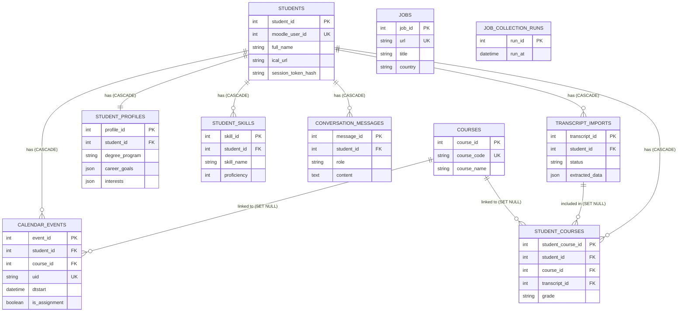

# DAIA — Database Reference

## 1. Overview

DAIA persists everything it knows about a student in a single SQLite file:

| Domain | Tables | Purpose |
|--------|--------|---------|
| **Identity & Moodle** | `students`, `courses`, `calendar_events` | Moodle onboarding, iCal sync, assignment detection |
| **Student profile** | `student_profiles`, `student_skills` | Preferences, goals, interests, skills |
| **Conversation** | `conversation_messages` | Chat history for memory + audit |
| **Transcripts** | `transcript_imports`, `student_courses` | Import history and per-student course snapshots |
| **Jobs** | `jobs`, `job_collection_runs` | Job-market data pipeline |
| **Misc** | `student_context` | Scaffold for a future FastAPI context endpoint |

The schema is designed around **one StudentModel per Moodle account**, with cascading deletes so removing a student cleans up all dependent rows.

### Design principles

1. **Idempotency.** Calendar sync upserts by `uid`; transcript upsert is keyed by `(student_id, course_code)`.
2. **JSON for flexible fields.** `career_goals`, `interests`, and `extracted_data` are JSON columns so the UI can evolve without migrations.
3. **Soft global uniqueness only where safe.** `courses.course_code` is globally unique (a documented limitation); per-student rows live in `student_courses`.
4. **No cross-student reads.** Every tool query filters by `student_id` except the job pipeline and `courses` catalogue.

---

## 2. Connection & sessions

### 2.1 Engine configuration

```
# src/database.py
from src.config import DATABASE_URL

connect_args = {}
if DATABASE_URL.startswith("sqlite"):
    connect_args = {"check_same_thread": False}
    os.makedirs(os.path.dirname(DATABASE_URL.replace("sqlite:///", "")) or ".", exist_ok=True)

engine = create_engine(DATABASE_URL, connect_args=connect_args)
SessionLocal = sessionmaker(autocommit=False, autoflush=False, bind=engine)
```

* `check_same_thread=False` is required because Gradio + async MCP calls cross thread boundaries.
* The data directory is created on import if missing.
* There is **no WAL mode, no busy_timeout, and no connection pool tuning** — adequate for a single-process deployment, not for concurrent writers.

### 2.2 Session pattern

Every tool and service uses the context-manager pattern:

```
from src.database import SessionLocal

with SessionLocal() as db:
    student = db.query(StudentModel).filter_by(moodle_user_id=123).first()
    ...
```

Do **not** hold a `SessionLocal` across `yield` boundaries or Gradio events — the session outlives the request and leaks.

### 2.3 Transaction semantics

* `autocommit=False` and `autoflush=False` — you must call `db.commit()` explicitly.
* `init_db()` runs `Base.metadata.create_all(bind=engine)` and an `_ensure_auth_columns()` migration (see §8).
* `transcript_service.import_transcript` uses nested `with db.begin()` for the academic-write phase so partial failures roll back cleanly.

---

## 3. Schema

All tables inherit from `src.database.Base` (`DeclarativeBase`).

### 3.1 `students`

**Model:** `StudentModel` (`src/models/calendar_models.py`)

| Column | Type | Constraints | Notes |
|--------|------|-------------|-------|
| `student_id` | `INTEGER` | PK, autoincrement | Internal DB ID |
| `moodle_user_id` | `INTEGER` | NOT NULL, UNIQUE, INDEX | Extracted from iCal URL `userid=` |
| `full_name` | `VARCHAR(255)` | NOT NULL | Set at onboarding |
| `email` | `VARCHAR(255)` | UNIQUE, NULL | Reserved |
| `ical_url` | `TEXT` | NULL | **Contains a private Moodle token** |
| `last_synced_at` | `DATETIME` | NULL | Last successful calendar sync |
| `created_at` | `DATETIME` | default `utcnow` | |
| `session_token_hash` | `VARCHAR(128)` | NULL | SHA-256 of remember-me token |
| `session_token_expires` | `DATETIME` | NULL | 30-day TTL |

**Cascades:** deleting a student deletes their `calendar_events`, `student_profiles`, `student_skills`, `conversation_messages`, and `student_courses` (all `ON DELETE CASCADE`).

---

### 3.2 `courses`

**Model:** `CourseModel`

| Column | Type | Constraints | Notes |
|--------|------|-------------|-------|
| `course_id` | `INTEGER` | PK, autoincrement | |
| `course_code` | `VARCHAR(50)` | NOT NULL, **UNIQUE**, INDEX | ⚠️ Globally unique |
| `course_name` | `VARCHAR(255)` | NOT NULL | |
| `moodle_course_id` | `INTEGER` | NULL | Reserved |
| `created_at` | `DATETIME` | default `utcnow` | |

**Known limitation.** `course_code` is globally unique, so two students in different programmes with the same code (e.g. `CS101`) collide. The sync service will reuse the first-created row, which means the second student's course name may be wrong. `student_courses` exists as the correct per-student snapshot but is not yet the primary read path.

---

### 3.3 `calendar_events`

**Model:** `CalendarEventModel`

| Column | Type | Constraints | Notes |
|--------|------|-------------|-------|
| `event_id` | `INTEGER` | PK, autoincrement | |
| `student_id` | `INTEGER` | FK `students.student_id`, NOT NULL, CASCADE | |
| `course_id` | `INTEGER` | FK `courses.course_id`, NULL, `SET NULL` | |
| `uid` | `VARCHAR(255)` | NOT NULL, **UNIQUE**, INDEX | Moodle UID (globally unique) |
| `summary` | `VARCHAR(500)` | NOT NULL | Event title |
| `description` | `TEXT` | NULL | |
| `location` | `VARCHAR(255)` | NULL | |
| `dtstart` | `DATETIME` | NOT NULL, INDEX | Start / deadline |
| `dtend` | `DATETIME` | NULL | |
| `class_visibility` | `VARCHAR(20)` | default `'PUBLIC'` | iCal `CLASS` |
| `last_modified` | `DATETIME` | NULL | |
| `dtstamp` | `DATETIME` | NULL | |
| `is_assignment` | `BOOLEAN` | default `False`, INDEX | **Homework vs lecture** |
| `created_at` | `DATETIME` | default `utcnow` | |
| `updated_at` | `DATETIME` | default `utcnow`, onupdate | |

**Composite index:** `idx_student_date (student_id, dtstart)`.

**`is_assignment` heuristic** (`moodle_sync_service.sync_calendar_to_db`):

```
assignment_keywords = [
    "due", "submission", "quiz", "exam", "closes", "deadline",
    "homework", "project", "assignment",
]
search_text = f"{summary} {description}".lower()
is_assignment = any(kw in search_text for kw in assignment_keywords)
```

The assignment tools (`src/tools/assignments.py`) filter on `is_assignment == True`, so lectures and site-maintenance events never appear in "what's due?" answers.

**Idempotency:** `sync_calendar_to_db` upserts by `uid`. Re-running a sync updates `summary`, `description`, `dtstart`, `dtend`, `last_modified`, and `is_assignment` without creating duplicates.

---

### 3.4 `student_profiles`

**Model:** `StudentProfileModel` (`src/models/student_models.py`)

| Column | Type | Constraints | Notes |
|--------|------|-------------|-------|
| `profile_id` | `INTEGER` | PK, autoincrement | |
| `student_id` | `INTEGER` | FK `students.student_id`, NOT NULL, **UNIQUE**, CASCADE | One profile per student |
| `degree_program` | `VARCHAR(255)` | NULL | |
| `current_semester` | `INTEGER` | NULL | |
| `career_goals` | `JSON` | NULL, default `{}` | `{"short_term": "...", "long_term": "..."}` |
| `interests` | `JSON` | NULL, default `[]` | `["AI agents", "deep learning"]` |
| `study_hours_per_week` | `FLOAT` | NULL | |
| `preferred_study_time` | `VARCHAR(50)` | NULL | `morning / afternoon / evening / night` |
| `created_at` | `DATETIME` | default `utcnow` | |
| `updated_at` | `DATETIME` | default `utcnow`, onupdate | |

**Merge semantics** (`src/tools/profile.py::update_student_profile`):

| Field | Default | `replace=True` |
|-------|---------|----------------|
| `interests` | union with existing | replace |
| `career_goals` | shallow merge (update keys) | replace |
| scalars | replace | replace |

`replace=True` is used by `detect_forgets` so "forget my study time" actually clears the field instead of merging with the prior value.

---

### 3.5 `student_skills`

**Model:** `StudentSkillModel`

| Column | Type | Constraints | Notes |
|--------|------|-------------|-------|
| `skill_id` | `INTEGER` | PK, autoincrement | |
| `student_id` | `INTEGER` | FK `students.student_id`, NOT NULL, CASCADE | |
| `skill_name` | `VARCHAR(100)` | NOT NULL | Stored lowercased by `add_or_update_skill` |
| `proficiency` | `INTEGER` | NULL | 1–5 |
| `evidence` | `TEXT` | NULL | Free text |
| `source` | `VARCHAR(50)` | default `'self_reported'` | `self_reported / transcript` |
| `last_updated` | `DATETIME` | default `utcnow`, onupdate | |

**Uniqueness:** no DB constraint, but `add_or_update_skill` performs a case-insensitive lookup on `(student_id, skill_name)` before inserting.

**Ordering:** `get_student_skills` orders by `proficiency DESC NULLS LAST`.

---

### 3.6 `conversation_messages`

**Model:** `ConversationMessageModel`

| Column | Type | Constraints | Notes |
|--------|------|-------------|-------|
| `message_id` | `INTEGER` | PK, autoincrement | |
| `student_id` | `INTEGER` | FK `students.student_id`, NOT NULL, CASCADE | |
| `conversation_id` | `VARCHAR(100)` | NOT NULL | One UUID per user+assistant pair |
| `role` | `VARCHAR(20)` | NOT NULL | `user / assistant` |
| `content` | `TEXT` | NOT NULL | |
| `created_at` | `DATETIME` | default `utcnow` | |

**Read pattern** (`src/memory/conversation_memory.py`):

```
db.query(ConversationMessageModel)
  .filter_by(student_id=student_id)
  .order_by(ConversationMessageModel.created_at.desc())
  .limit(limit)
  .all()
```

`get_recent_messages` reverses the result so callers see chronological order.

**Growth:** this table grows unbounded. For long-lived deployments add a retention job (e.g. delete rows older than 90 days) or a summarisation pass.

---

### 3.7 `transcript_imports`

**Model:** `TranscriptImportModel` (`src/models/transcript_models.py`)

| Column | Type | Constraints | Notes |
|--------|------|-------------|-------|
| `transcript_id` | `INTEGER` | PK, autoincrement | |
| `student_id` | `INTEGER` | FK `students.student_id`, NOT NULL, CASCADE, INDEX | |
| `filename` | `VARCHAR(255)` | NOT NULL | Sanitised basename |
| `file_type` | `VARCHAR(10)` | NOT NULL, default `'pdf'` | |
| `file_hash` | `VARCHAR(64)` | NOT NULL | SHA-256 of file bytes |
| `status` | `VARCHAR(20)` | NOT NULL, default `'processing'` | `processing / completed / failed` |
| `extracted_data` | `JSON` | NULL | Validated `TranscriptExtraction` |
| `error_message` | `TEXT` | NULL | Safe, user-displayable |
| `model_id` | `VARCHAR(100)` | NULL | Model used for extraction |
| `prompt_version` | `VARCHAR(50)` | NULL | e.g. `transcript-v1` |
| `created_at` | `DATETIME` | NOT NULL, default `utcnow` | |
| `completed_at` | `DATETIME` | NULL | |

**Composite index:** `idx_transcript_student_created (student_id, created_at)`.

**Audit trail:** a row is created **before** processing so failures are recorded even if the model call or DB writes fail. `extracted_data` stores the validated model output, never the raw PDF text.

---

### 3.8 `student_courses`

**Model:** `StudentCourseModel`

| Column | Type | Constraints | Notes |
|--------|------|-------------|-------|
| `student_course_id` | `INTEGER` | PK, autoincrement | |
| `student_id` | `INTEGER` | FK `students.student_id`, NOT NULL, CASCADE, INDEX | |
| `course_id` | `INTEGER` | FK `courses.course_id`, NULL, `SET NULL`, INDEX | Link to shared catalogue |
| `course_code` | `VARCHAR(50)` | NULL | Snapshot (may be NULL) |
| `course_name` | `VARCHAR(255)` | NOT NULL | Snapshot |
| `transcript_id` | `INTEGER` | FK `transcript_imports.transcript_id`, NULL, `SET NULL`, INDEX | Latest source |
| `grade` | `VARCHAR(30)` | NULL | Original notation preserved |
| `credits` | `FLOAT` | NULL | |
| `completion_status` | `VARCHAR(30)` | NULL | `completed / in_progress / failed / withdrawn` |
| `completed_at` | `DATETIME` | NULL | |
| `source` | `VARCHAR(30)` | NOT NULL, default `'transcript'` | |
| `created_at` | `DATETIME` | NOT NULL, default `utcnow` | |
| `updated_at` | `DATETIME` | NOT NULL, default `utcnow`, onupdate | |

**Uniqueness:** `UNIQUE (student_id, course_code)` — `uq_student_course_code`. Multiple `NULL` course codes are permitted by SQLite.

**Composite index:** `idx_student_courses_student_name (student_id, course_name)`.

**Upsert logic** (`transcript_service._upsert_course_record`):

1. Match `courses` by normalised `course_code` (uppercase, no whitespace).
2. Insert into `courses` if absent.
3. Find `student_courses` by `(student_id, course_code)`; fall back to name-based match only when `course_code IS NULL`.
4. Preserve previously known `grade`, `credits`, `completion_status`, `completed_at` when the new extraction has `None`.
5. Always update `transcript_id` to the latest import.

---

### 3.9 `jobs`

**Model:** `JobModel` (`src/models/job_models.py`)

| Column | Type | Constraints | Notes |
|--------|------|-------------|-------|
| `job_id` | `INTEGER` | PK, autoincrement | |
| `title` | `VARCHAR(255)` | NOT NULL | |
| `company` | `VARCHAR(255)` | NULL | |
| `location` | `VARCHAR(255)` | NULL | Jobicy `jobGeo` |
| `country` | `VARCHAR(100)` | NULL, INDEX | Grouped in the sidebar |
| `url` | `VARCHAR(500)` | NOT NULL, **UNIQUE**, INDEX | Deduplication key |
| `industry` | `VARCHAR(255)` | NULL | Jobicy `jobIndustry` (the "Stack") |
| `salary` | `VARCHAR(255)` | NULL | `"min-max currency"` |
| `created_at` | `DATETIME` | NOT NULL, default `utcnow`, INDEX | |
| `is_active` | `BOOLEAN` | default `True`, INDEX | |

**Write path:** `src/tools/jobs_db.py::save_jobs_to_db` — skips rows whose `url` already exists.

**Read path (sidebar):** `src/collectors/health.py::get_collection_health` counts active jobs and groups by `country` (top 5).

---

### 3.10 `job_collection_runs`

**Model:** `JobCollectionRunModel`

| Column | Type | Constraints | Notes |
|--------|------|-------------|-------|
| `run_id` | `INTEGER` | PK, autoincrement | |
| `status` | `VARCHAR(50)` | NOT NULL, default `'success'` | |
| `jobs_added` | `INTEGER` | default `0` | |
| `run_at` | `DATETIME` | NOT NULL, default `utcnow` | |

**Read path:** the latest row powers `last_successful_run_at` in the **Job Market Data** sidebar panel.

> **Note.** The table is written by `save_jobs_to_db` after every batch. The `status` column is not used for filtering; the health probe simply reads the newest row regardless of status.

---

### 3.11 `student_context` (scaffold)

**Model:** `StudentContextDB` (`src/models/student_context.py`)

| Column | Type | Constraints | Notes |
|--------|------|-------------|-------|
| `student_id` | `VARCHAR` | PK, default `'default'` | String key |
| `payload` | `JSON` | NOT NULL, default `{}` | Validated `StudentContext` |
| `updated_at` | `DATETIME(tz)` | NOT NULL, default `now(utc)`, onupdate | |

**Status:** not created by `init_db()` and not imported by the running app. It is a scaffold for a future FastAPI context endpoint (`src/services/student_context_service.py`). **Do not rely on it** — the service module currently contains a typo (`sqlalhemy`) and will not import.

---

## 4. Entity-Relationship Graph

The following diagram illustrates the foreign key relationships between the database tables. 



*Note: `JOBS`, `JOB_COLLECTION_RUNS`, and `STUDENT_CONTEXT` are standalone tables with no foreign key dependencies on the core student graph.*

---

## 5. Indexes & constraints summary

| Table | Index / constraint | Purpose |
|-------|--------------------|---------|
| `students` | `moodle_user_id` UNIQUE | Login lookup |
| `students` | `session_token_hash` (implicit via UNIQUE? no — plain column) | Remember-me verify |
| `courses` | `course_code` UNIQUE | Catalogue dedupe |
| `calendar_events` | `uid` UNIQUE | Idempotent sync |
| `calendar_events` | `dtstart` | Upcoming queries |
| `calendar_events` | `is_assignment` | Assignment filter |
| `calendar_events` | `idx_student_date (student_id, dtstart)` | Date-range per student |
| `student_profiles` | `student_id` UNIQUE | One profile per student |
| `transcript_imports` | `idx_transcript_student_created` | History pagination |
| `student_courses` | `uq_student_course_code` | Per-student dedupe |
| `student_courses` | `idx_student_courses_student_name` | Name fallback lookup |
| `jobs` | `url` UNIQUE | Deduplication |
| `jobs` | `country` | Sidebar grouping |
| `jobs` | `is_active` | Active-job filter |
