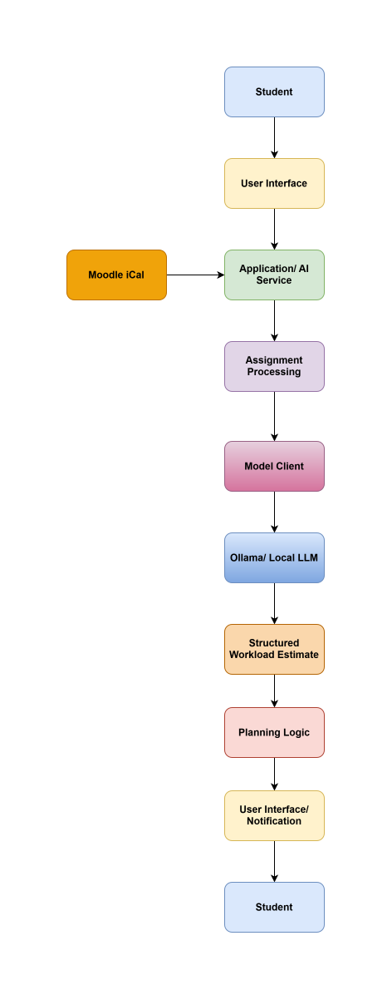
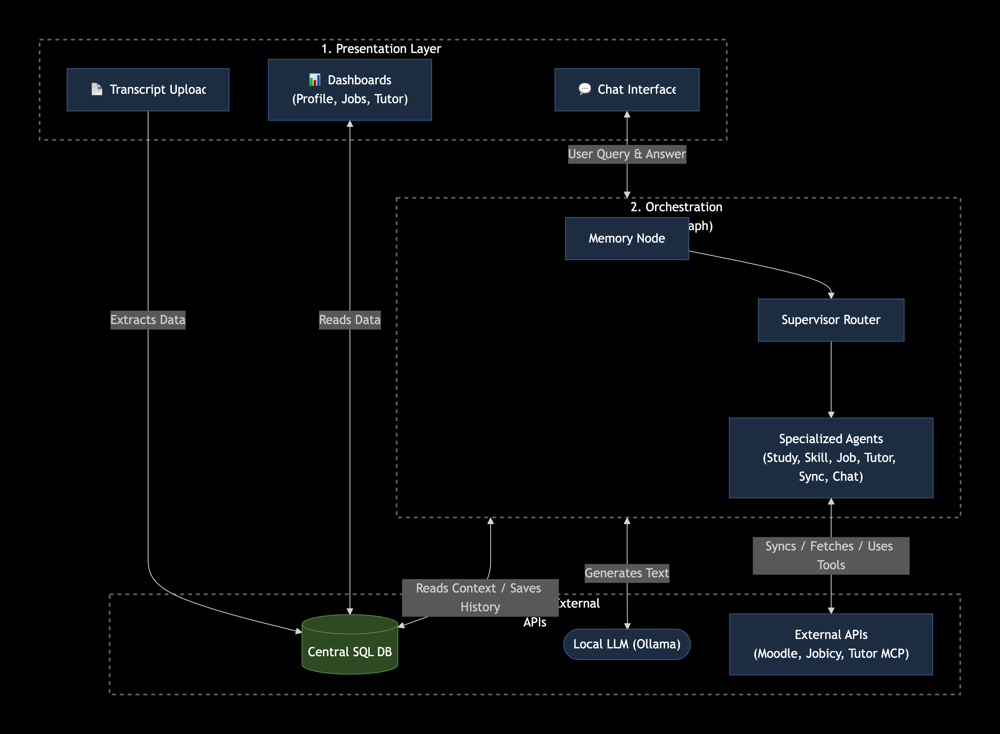
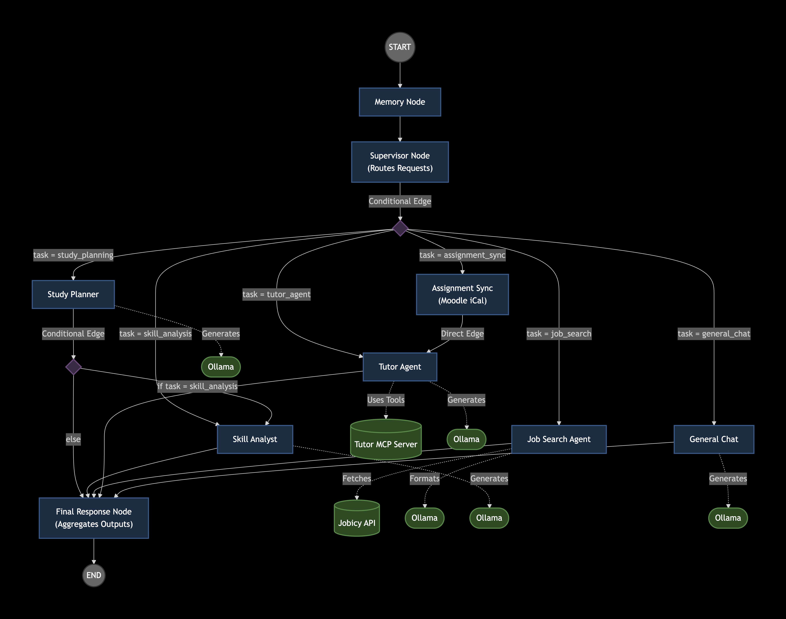
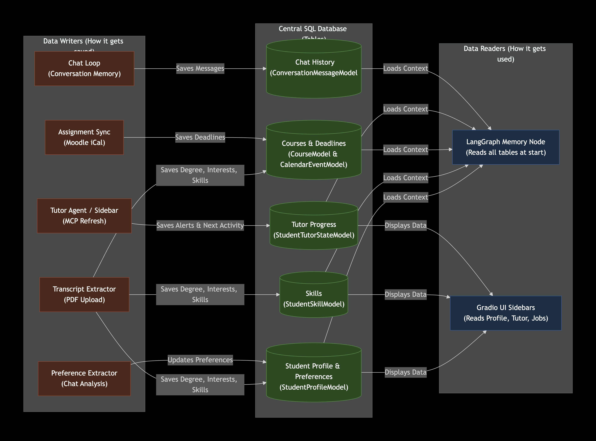

# DAIA — System Architecture

> **Audience:** Developers, architects, and reviewers.
> **Scope:** High-level system design, authentication, data flow, memory loop, and component interactions.
> **Related Docs:** [Agent Graph](AGENT_GRAPH.md) · [Database Schema](DATABASE.md) · [Tutor MCP](TUTOR-MCP.md)

---

## 1. System Diagram

**Initial architecture:**

> **Core Architectural Rule:** The user interface does not communicate directly with the model or Ollama. Model interaction passes through the application/service layer, which enforces authentication, context loading, memory updates, and caching.

**System Overview:**

**LangGraph Topology:**

*(See [Agent Graph](AGENT_GRAPH.md) for detailed node logic and routing rules.)*

---

## 2. Authentication & Session Cache

**Register / Login / Logout**
- Passwords are **bcrypt-hashed**.
- Sessions are delivered as **HTTP-only cookies**.
- Sessions are **stored in SQLite** (the `students.session_token_hash` / `students.session_token_expires` columns).

**Session store (SQLite)**
- **Authoritative** source of truth.
- **Survives restarts.**
- **TTL:** 8 hours.

**Session cache (in-memory, `TTLCache`)**

Performance-only layer — never authoritative:

| Cached item | TTL | What it skips |
| :--- | :--- | :--- |
| `student_context` | **60 s** | The Memory Node's ~5 SQL queries |
| Chat answers | **300 s** | The LLM call on repeat questions |

**Invalidation rules**
- Cleared on **logout**.
- Cleared on **profile update** (any `update_student_profile` write).

---

## 3. Data Flow (One Request)

**Step-by-step:**

1. **Browser → `require_session()`** — validate the HTTP-only cookie against the SQLite session store. Reject if expired or missing.
2. **`require_session()` → `agent_service`** — hand off the authenticated `student_db_id` and the user message.
3. **Context cache check** — if `student_context` is fresh (< 60 s), skip the Memory Node entirely (avoids ~5 SQL queries).
4. **Answer cache check** — if the exact question was answered in the last 300 s for this student, return the cached answer without invoking the LLM.
5. **LangGraph** — run the supervisor graph (memory → supervisor → specialist → final response).
6. **LLM** — invoked by the routed specialist node.
7. **Save messages** — persist both the user turn and the assistant reply to `conversation_messages`.
8. **Cache** — store the new `student_context` (60 s) and the answer (300 s).
9. **Return** — stream the final response back to the browser.

---

## 4. Closed Memory Loop

After every response, the LLM extracts durable preferences (e.g., *"I prefer studying in the evening"*) and merges them into `student_profiles`. The next request's Memory Node sees the updated profile — **this is how DAIA learns.**
